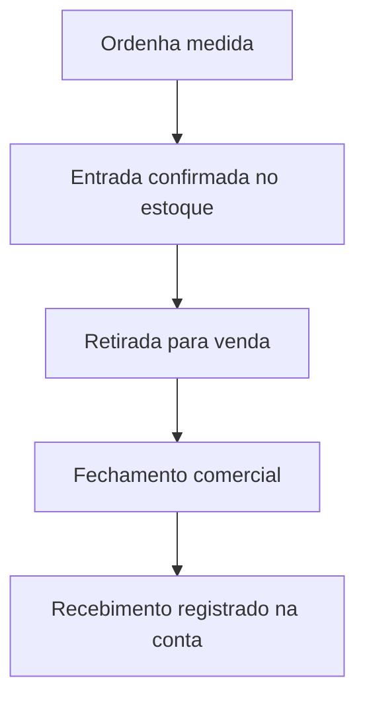

# Acompanhar um resultado até a origem

## Uma história atravessando os eixos

Uma vaca entra no rebanho com identidade e localização comprovadas. A dieta do lote recebe vigência; o fechamento confirma consumo e atribui custo pelos dias de presença. Uma aplicação usa material do estoque e preserva carência. A tentativa reprodutiva registra a intervenção; o diagnóstico confirma gestação. O parto cria as crias vivas e pode abrir lactação quando informado.

Cada ordenha mede leite; a confirmação cria origem física. A natureza e as carências limitam sua destinação. Uma coleta retira leite antes ou depois de negociar preço. O fechamento comercial cria venda e condição financeira. A liquidação registra o recebimento na conta. Relatórios reúnem os fatos pelo recorte correto, sem somar compra, consumo e pagamento como despesas diferentes.

## As quatro perguntas que evitam confusão

| Pergunta | Exemplo | Fonte |
|---|---|---|
| Como está o animal na data? | Gestante e lactante | Evidências reprodutivas e lactação |
| Qual é o estado do registro? | Aplicação válida ou anulada | Histórico do fato |
| Que leite existe e qual sua natureza? | 10 L de colostro disponíveis | Origem, classificação e movimentos |
| O que aconteceu com o dinheiro? | R$ 500 ainda a receber | Compromisso e liquidações |

Uma resposta não substitui a outra. “Descarte” pode ser restrição reprodutiva da matriz, natureza não comercial do leite ou eliminação física, conforme o contexto. Confira se está olhando a ficha da matriz, a natureza da produção ou um movimento do estoque.

## Preparar e conferir um relatório

Em **Pecuária → Relatórios**, escolha a consulta e o sítio. Defina o período e confira população, unidade e cobertura. No construtor, selecione a fonte, escolha as variáveis e ajuste a ordem das colunas. Verifique se o resultado ou a exportação cobre a página exibida ou o período inteiro. Um modelo salvo guarda a seleção de campos para uso posterior.

Para recuperar exatamente o que foi emitido, abra a emissão no histórico. Para conhecer a posição atual depois de uma correção, faça uma nova consulta. Na produção de leite, uma retirada para Casa ou Funcionários tem destino próprio e pode ser conferida separadamente do descarte físico. A exibição de valores depende da sua permissão atual.

