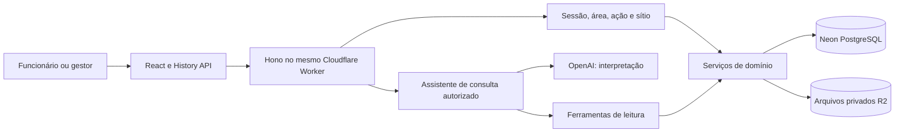
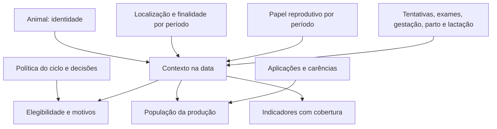
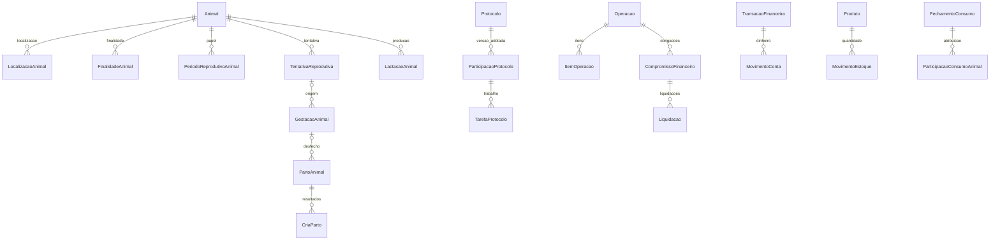
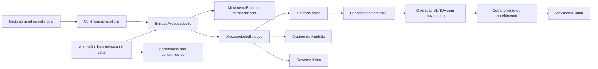

# System design — integração dos domínios até a V5

Este documento descreve o sistema implementado na `main` que integra a V5 (`b63931e4`). [ARCHITECTURE.md](../ARCHITECTURE.md) mantém runtime, organização e limites técnicos; os contratos de domínio detalham os comandos. Diagramas são modelos conceituais, não um catálogo completo de colunas ou prova do banco implantado.

## Contexto e infraestrutura

Node atende desenvolvimento/testes; produção usa exclusivamente Workers. O frontend usa `/api` relativo. `worker.ts` e `index.ts` compartilham `app.ts`, com adapters de banco apropriados. O assistente financeiro não envia resultados financeiros ao modelo nem executa escrita. Bot legado e WhatsApp estão suspensos.

## Fronteiras funcionais

| Domínio | Dono do fato | Integrações permitidas |
|---|---|---|
| Financeiro | Operação, obrigação, transação, movimento de conta e período | Compras/vendas originam efeitos físicos; Serviços podem atribuir custos a procedimentos |
| Estoque | Movimento físico, partida, base/parcelas de valor | Núcleo usado por todos os consumos e pelo leite |
| Rebanho | Identidade, localização, finalidade, categoria, baixa, genética e peso | Fornece contexto histórico para todos os fatos animais |
| Reprodução | Tentativa, gestação, parto, lactação, política e acompanhamento | Consome material; gera crias; usa exames/protocolos comuns |
| Sanidade/protocolos | Ocorrência, aplicação, exame, versão, participação e tarefa | Consumo, carência, restrição e interpretação reprodutiva |
| Nutrição | Receita, vigência, fechamento e participação por animal-dias | Consome estoque e leite; conserva custo e referência comercial separados |
| Produção | Medição, origem leiteira, natureza, destino, qualidade e operação comercial | Confirma estoque; fecha venda pelo motor financeiro; fornece leite à Nutrição |

O agrupamento editorial “Financeiro → Estoque” não muda essa propriedade funcional. Não há sincronização contínua com IDEAGRI: carga inicial/reconciliação têm executores e validações próprios.

## Fatos, projeções e snapshots

Fatos têm identidade, data operacional, autor e sítio na data. Projeções calculam estados a partir dos fatos válidos: categoria, situação reprodutiva, lactação, carência, saldo, cobertura e indicadores. Snapshots preservam a referência utilizada: versão de protocolo, perfil de produto, formato de exame, genética, evidência de origem e emissão de relatório.

O sistema usa fatos e auditoria, mas não é descrito como uma arquitetura integral de event sourcing: há tabelas relacionais, atualizações controladas, versões e inversos conforme cada contrato. Consulta atual e retrato emitido têm semânticas distintas.

## Relações principais

As cardinalidades mostram vínculos conceituais possíveis; unicidade de fatos válidos/abertos depende das constraints parciais e das guardas do domínio. Uma cria sem vida não implica Animal ativo; gestação pode ter origem sem tentativa comprovada.

## Caminho leiteiro e ausência de duplicação

Na fonte GERAL, o individual é acompanhamento e não outra origem física. Medições positivas confirmadas geram origens; classificação protege destinação; alocações ligam saídas aos litros de cada origem. Preço de venda e referência R07 não substituem apuração de custo.

## Escrita e consistência

Rotas Hono validam Zod e aplicam sessão/área/ação/escopo; serviços validam relações e coordenam transações; cálculos puros ficam em `*.calc.ts`. A confirmação repete as verificações da prévia porque saldo, versão e contexto podem mudar.

Comandos sujeitos a reenvio preservam chave, conteúdo, autoria e sítio. Repetição idêntica recupera resultado; conteúdo divergente conflita. Versão esperada impede sobrescrita silenciosa. Locks de animais/produtos/agregados e transações serializáveis coordenam os caminhos implementados; não se presume que qualquer novo fluxo seja protegido sem examinar sua ordem de travas.

Parto/crias, tentativa/consumo e confirmação de conjunto leiteiro mantêm atomicidade. O executor comum de protocolos v1 é por ação/contexto, com até cem animais distintos. Visitas coordenam grupos no seu próprio fluxo; não se deve encadear chamadas HTTP independentes e anunciar atomicidade global.

## Persistência e SQL

`public` contém Financeiro, Estoque, Auth e Sítios; `pecuaria` contém fatos e vínculos animais/leiteiros. A estrutura instalada pelo repositório parte de `server/prisma/migrations/20261025000000_base_unificada/migration.sql`. A cadeia anterior foi consolidada no merge V5 e permanece no Git. Evoluções posteriores são migrations incrementais; não se reescreve a baseline aplicada.

SQL complementa Prisma com CHECKs, FKs restritas, índices únicos parciais e triggers. Exemplos conferidos na baseline: proteção da identidade da sessão de leite; imutabilidade da entrada/emissão; validação da finalidade na origem; conservação de alocações e valor; proteção de versão de protocolo e snapshot de tarefa; vínculo imutável de qualidade no fechamento.

Uma instalação com histórico da cadeia antiga exige reconciliação específica antes de aplicar a baseline. Não tratar `migrate deploy` como migração automática de um banco populado para uma baseline recriada. Views de compatibilidade, inclusive DestinoAnimal e projeções IATF, preservam contratos antigos e não criam fontes concorrentes de escrita.

## Autorização e arquivos

Seleção de sítio na interface é preferência, não autorização. Relacionamentos e DTOs devem respeitar o sítio histórico. Monetário pode ser oculto, não apurado ou parcial; cada situação mantém sua semântica. Custos operacionais atribuídos têm política pecuária própria; edição/preço/documentos financeiros e referência comercial têm gates financeiros.

R2 mantém objetos privados por namespace. Uploads diretos preservam intent/contexto, conteúdo e confirmação; download revalida vínculo e autorização. Arquivos já referenciados não recebem chave nova por uma reorganização documental.

## Verificação e limites

Há testes puros, contratos HTTP/componentes, serviços com dependências simuladas, integrações PostgreSQL e verificações SQL estruturais. O CI define jobs de build/testes, invariantes financeiros e baseline/seed unificada; não faz deploy. R2 real, execução no Worker/Neon, concorrência por cenário e homologação da fazenda precisam de evidências próprias.

Esta revisão confrontou arquivos e contratos. Não iniciou o servidor migratório, aplicou SQL, carregou seed, acessou produção ou executou uma homologação funcional completa. O [registro de lacunas](lacunas.md) explicita o que permanece desconhecido ou fora do escopo.
